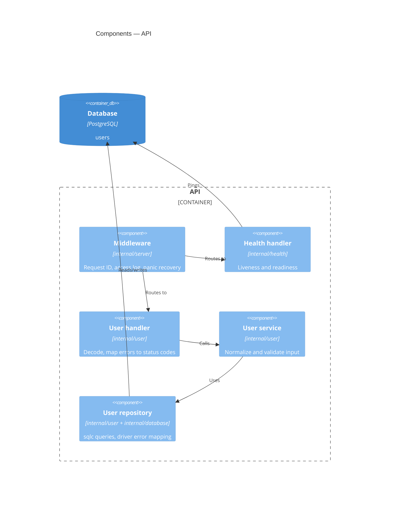

# C4 — Component diagram: API

> **AI-DLC phase:** `02-design`  ·  Level 3 (components inside a container).

## Rules / behavior
1. Only the handler knows HTTP; only the repository knows PostgreSQL.
2. Domain errors (`ErrNotFound`, `ErrEmailTaken`, `ValidationError`) are the contract between layers.
