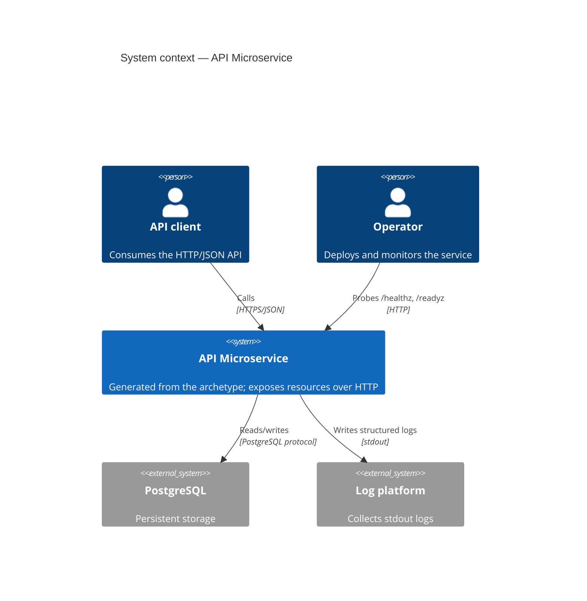

# C4 — Context diagram

> **AI-DLC phase:** `02-design`  ·  Level 1 (the system in its environment).

**Notes**
- TLS termination is expected at the ingress / load balancer in front of the service.
